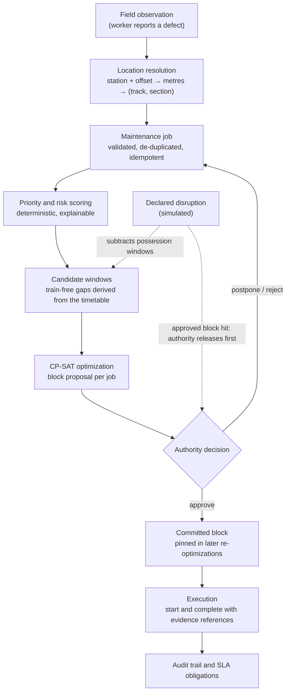
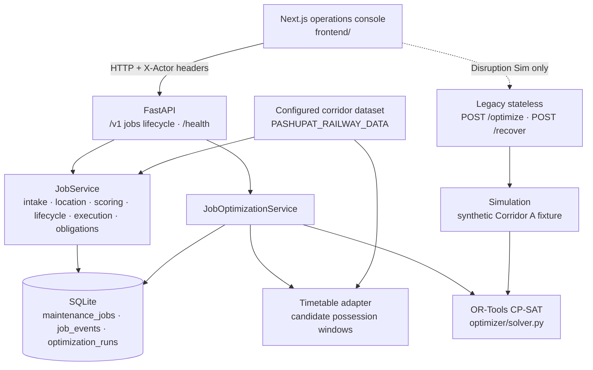
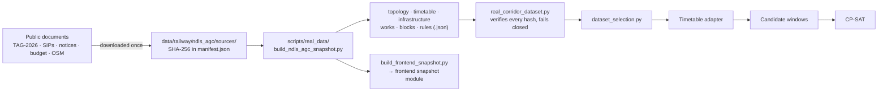

# Pashupatastra

**Maintenance block planning and decision support for Indian Railways.** Pashupatastra
turns field defect reports into scored maintenance jobs, proposes conflict-free
maintenance blocks in train-free windows using Google OR-Tools CP-SAT, and routes every
proposal through a human authority before any work starts. Every step is recorded in an
append-only audit trail.

Built for **Smart India Hackathon 2026**, problem statement **SIH26027**: automatic
block planning that maximises asset availability for train operations.

> **The optimizer proposes. A human authority decides. The audit trail records.**

The prototype runs fully offline on a hash-verified snapshot of **published Indian
Railways data** for the New Delhi to Agra Cantt. corridor. It uses the Trains at a
Glance 2026 timetable, signal interlocking plans, budget works, block notices and
station geography. Planning inputs that are not published, such as freight paths,
possession grants and asset condition, are derived by stated rules or labelled as
demo inputs. They are never presented as real.

---

## Contents

[Why this matters](#why-block-planning-is-hard) ·
[Workflow](#end-to-end-workflow) ·
[Capabilities](#key-capabilities) ·
[Data governance](#real-railway-data-and-data-governance) ·
[Corridor](#the-modelled-corridor) ·
[Architecture](#architecture) ·
[Quick start](#quick-start) ·
[Judge walkthrough](#5-minute-judge-walkthrough) ·
[Optimization model](#optimization-model) ·
[Testing](#testing) ·
[Trust model](#security-and-trust-model) ·
[Limitations](#limitations) ·
[Data sources](#data-sources) ·
[Repository map](#repository-structure)

---

## Why block planning is hard

Track, signalling and overhead-equipment maintenance on a busy trunk route can only
happen while a section of line is closed to traffic (a *block* or *possession*). Each
block takes capacity away from trains. Planners have to:

- decide **which defects are most urgent** when there are more jobs than free track time;
- find **train-free windows** on the right line and section, with safety margins;
- avoid **conflicting blocks** on the same stretch of line;
- keep **already-approved blocks stable** when the plan is recomputed;
- have every decision **approved by an accountable authority**, then prove the work
  was done.

These steps are usually done by hand, and the reasons behind a decision are rarely kept.
Pashupatastra makes each step explicit, repeatable and recorded.

## End-to-end workflow



| Stage | What actually happens | Where |
|---|---|---|
| **Field observation** | A worker submits a report with job type, severity, crew size, description and an evidence reference. | `POST /v1/jobs` |
| **Location resolution** | The report gives *from station → toward station + offset in metres*. This is converted through the section registry to corridor-absolute metres and resolved to exactly one `(track, section)`. Spans that straddle a station boundary are refused. | `jobs/field_location.py`, `jobs/resource_resolution.py` |
| **Maintenance job** | The request is validated. The nearest demo asset is associated, possible duplicates are flagged, and a client idempotency key makes retries safe. | `jobs/service.py`, `asset_association.py`, `duplicate_detection.py`, `idempotency.py` |
| **Scoring** | A fixed-weight, 7-feature baseline produces `priority_score`, `risk_score` and a ranked explanation. This is **not a trained model**, and it is labelled `BASELINE_DETERMINISTIC`. | `ml/scorer.py` |
| **Candidate windows** | Train-free gaps per `(track, section)` are derived from the timetable, with a 10-minute safety buffer and a 20-minute minimum window. | `data/timetable_adapter.py` |
| **CP-SAT** | Chooses which jobs to schedule and when, under hard constraints. The result is a stored optimization run and one block proposal per job. | `optimizer/solver.py`, `jobs/optimization.py` |
| **Authority decision** | Approve (commit), postpone (not-before date), reject or release. Each decision names the proposal run it reviewed, so a stale decision is refused (`409 STALE_PROPOSAL`). | `jobs/lifecycle.py` |
| **Execution** | Start with before-work evidence and complete with after-work evidence, or record not-completed with a reason. | `jobs/execution.py` |
| **Audit and SLA** | Every transition and refusal is appended to job history. Response-time obligations are derived when read, against an explicitly *assumed* demo SLA policy. | `jobs/history.py`, `jobs/obligations.py`, `jobs/sla_policy.py` |

## Key capabilities

| Area | Capability |
|---|---|
| **Field intake** | Station and offset location model, metre-precise canonical locations, backend-side validation, idempotent submission, duplicate detection, nearest-asset association |
| **Scoring** | Deterministic 7-feature priority and risk scoring with ranked, human-readable contributors, stored with a model identity and version |
| **Planning** | Candidate windows derived from the timetable, CP-SAT block optimization, a two-day planning horizon (10–11 Sep 2026), and a stored record of each run's request, result and provenance |
| **Authority** | Approve, postpone, reject and release, with stale-proposal protection. Approved blocks are preserved across re-optimization |
| **Execution** | Evidence-gated start and completion (1–10 evidence references each), and a not-completed path with a reason |
| **Assurance** | Append-only job history and optimization runs (enforced by SQLite triggers), and SLA obligations with overdue and attention flags |
| **Disrupt / recover** | Declared (simulated) disruptions recorded append-only against the real job queue. Every optimization subtracts them from the derived possession windows; approved work they hit must be released by the authority before recovery; recovery is a real CP-SAT re-plan with a before/after comparison |
| **Synthetic sandbox** | The original stateless disruption what-if (asset breakdown, track unavailable, emergency work, possession curtailment) on a separate synthetic fixture |
| **Data** | Hash-verified public-data snapshot, per-field provenance classes, and a synthetic fallback dataset for regression |
| **Operations** | Deterministic demo seed and reset with a `--verify` rehearsal (plan and disrupt/recover), fully offline at runtime, a frozen `/v1` API contract, and a GitHub Actions workflow running the backend suite and the console checks |

## Real railway data and data governance

> **We use real, public railway data wherever it is published, and derive or clearly
> label only the inputs that are not publicly available.** The prototype distinguishes
> sourced data from derived planning inputs rather than presenting unavailable
> operational information as real.

Every field of the snapshot is covered by a provenance record
`{value, unit, class, source_ids, derived_from, derivation_method, confidence}`. The
class is one of six:

| Class | Meaning | Examples in this repository |
|---|---|---|
| `REAL` | Stated directly by a public source | Station names and codes (NDLS, NZM, FDB, PWL, MTJ, RKM, AGC); the 2022 corridor-block policy statement |
| `REAL_DATED_SNAPSHOT` | Read from a dated public document and kept as a snapshot | TAG-2026 train times for 23 trains; signal-interlocking-plan km-posts, level crossings and running lines; the 2026-27 sanctioned works; the Faridabad 2026 block notice; OpenStreetMap coordinates |
| `DERIVED_FROM_REAL` | Computed from real values by a stated method | NDLS-relative chainage; interpolated passing times; **candidate possession windows** |
| `ENGINEERING_ASSUMPTION` | A modelling choice, not a published fact | Two modelled running lines (UP-1, DOWN-1); the 10-minute safety buffer; the 20-minute minimum window; scoring inputs such as speed and density |
| `DEMO_MAINTENANCE_INPUT` | A controlled demonstration input | The seeded maintenance observations (grounded in real sanctioned-work categories on real sections); generated asset condition; evidence references |
| `UNAVAILABLE_PUBLICLY` | Searched for, not published, and not invented | Freight paths; EMU/MEMU operations; the working timetable (WTT); granted possessions; as-run train movements; defect-level asset condition |

**What is real.** The snapshot contains station codes, names and sequence; zone and
division ownership (Northern Railway, Delhi Division for NDLS–PWL; North Central
Railway, Agra Division for PWL–AGC); a verified subset of the *Trains at a Glance 2026*
timetable (12 UP and 11 DN trains, such as Gatiman Express, Shatabdi, Taj Express and
Vande Bharat); dated signal interlocking plans with km-posts, level crossings,
automatic-signalling sections and running lines; Kavach commissioning notices; sanctioned
works from the 2026-27 budget statements; the Faridabad 2026 power and traffic block;
and OpenStreetMap station coordinates.

**What is derived, and why.** Actual possession grants, freight schedules, EMU/MEMU
operations and the working timetable are not published. Pashupatastra therefore
**derives candidate possession windows** from the published passenger timetable. A train
occupies each section between its consecutive stops, the occupation is extended by a
safety buffer, and any remaining gap of at least 20 minutes becomes a candidate window.
These windows are labelled everywhere as
`CANDIDATE POSSESSION WINDOW - DERIVED FROM PUBLIC PASSENGER TIMETABLE`. Because
unpublished traffic is absent, a derived window can overstate free track. The
documentation, the UI and the tests all state this.

**Conservative provenance labelling.** Each optimization run reports its provenance on
four axes. In real mode these are topology `REAL_STATIC`, timetable `REAL_SCHEDULED`,
possession `SYNTHETIC` and asset condition `SYNTHETIC`. The run's overall label takes
the **weakest** axis, so a real-data run reports **`SYNTHETIC` overall**. This is
deliberate: a run is never labelled more real than its least-real input. The precise
class of the windows, `DERIVED_FROM_REAL`, is carried separately as
`possession_source = DERIVED_FROM_PUBLIC_TIMETABLE`.

**What is used as evidence only.** The real Faridabad (2026) and Mathura (2024) block
notices are displayed as context. They are **not applied** to the plan and are not a
possession feed.

## The modelled corridor

**New Delhi → Agra Cantt.**, about 195 km of electrified trunk route.

```text
NDLS ─── NZM ──────── FDB ────────── PWL ────────────────────── MTJ ─────────────── RKM ──── AGC
0 km     7 km         28 km          ~54.8 km                   141 km              ~190.9   ~194.8
└ Northern Railway · Delhi Division ─┘└────────── North Central Railway · Agra Division ──────────┘
```

| Section | From → To | Chainage (km) | Length (km) | Zone / Division |
|---|---|---|---|---|
| `NDLS-NZM` | New Delhi → Hazrat Nizamuddin | 0 – 7 | 7.0 | NR / Delhi |
| `NZM-FDB` | Hazrat Nizamuddin → Faridabad | 7 – 28 | 21.0 | NR / Delhi |
| `FDB-PWL` | Faridabad → Palwal | 28 – ~54.8 | 26.8 | NR / Delhi |
| `PWL-MTJ` | Palwal → Mathura Jn. | ~54.8 – 141 | 86.2 | NCR / Agra |
| `MTJ-RKM` | Mathura Jn. → Raja Ki Mandi | 141 – ~190.9 | 49.9 | NCR / Agra |
| `RKM-AGC` | Raja Ki Mandi → Agra Cantt. | ~190.9 – ~194.8 | 3.9 | NCR / Agra |

- **Chainage is NDLS-relative** (NDLS = 0) and derived. It is not the railway's own
  km-post datum, which runs from the Mumbai end. Whole kilometres come from the TAG
  distance column. Values marked `~` are derived from official km-posts in signal
  interlocking plans and carry a stated uncertainty. Palwal–Mathura has an unresolved
  ~2 km disagreement between sources, which is recorded in provenance. No finer precision
  is claimed.
- **Real geography vs. modelled sections.** The corridor has about 25 real intermediate
  stations (Okhla, Tughlakabad, Ballabgarh, Hodal, Kosi Kalan, Chhata, Vrindavan,
  Runakta and others). They are kept as reference data. The optimization model groups the
  line into six sections between the seven stations above, because section IDs anchor
  jobs, scope and authorization.
- **Direction.** Railway convention is used: **UP = away from Delhi**. `UP-1` carries
  NDLS→AGC trains and `DOWN-1` carries AGC→NDLS trains. The route has three or four
  running lines in places. The model uses two, as a stated engineering assumption.

## Architecture



`job_events` and `optimization_runs` are append-only. SQLite `BEFORE UPDATE` and
`BEFORE DELETE` triggers abort any modification, from any connection.

**Data pipeline.** The network is used once, when the snapshot is built, and never at
runtime:



**Snapshot integrity.** `manifest.json` records every source file's URL, publisher,
data-as-of date, licence note, coverage and SHA-256, plus the SHA-256 of each generated
dataset file. With `PASHUPAT_RAILWAY_DATA=real`, the backend refuses to start
(`RealSnapshotError`) if any hash differs, a file is missing, a provenance record cites
an unknown source, a derived value omits its derivation, or chainage is not increasing.
It **never falls back** to synthetic data. `.gitattributes` excludes `data/railway/**` from
line-ending conversion (`-text`), so the hashed bytes stay identical on every platform.

## Tech stack

| Layer | Technology |
|---|---|
| Frontend | Next.js 16 (App Router), React 19, TypeScript 5, Tailwind CSS 4. Fonts are self-hosted, so the console loads nothing from the internet |
| Backend | Python 3.11, FastAPI, Pydantic v2, Uvicorn |
| Optimization | Google OR-Tools CP-SAT (tested with 9.15) |
| Persistence | SQLite (standard library `sqlite3`) |
| Identity | `cryptography` (ES256 verification). NovaForge OIDC authorization-code + PKCE login with server-side sessions when `PASHUPAT_AUTH_MODE=novaforge`; see [trust model](#security-and-trust-model) |
| Testing | pytest, TypeScript `tsc --noEmit`, ESLint, `next build` |

There is no machine-learning framework: the scorer is plain, deterministic Python.

## Quick start

**Prerequisites:** Python 3.11+ and Node.js 20+ (tested with Python 3.11.9 and
Node 24). No network access is needed after the dependencies are installed.

### 1. Install

```bash
pip install -r requirements.txt
cd frontend && npm ci && cd ..
```

### 2. Seed the demo and start the backend (real public-data snapshot)

The seed script and the backend server must share the same three variables.
`PASHUPAT_JOBS_DB` must be an **absolute** path to a dedicated demo database, and the
script refuses to reset the repository-root `jobs.db`.

**Windows (PowerShell), from the repository root:**

```powershell
$env:PASHUPAT_CORRIDOR_ID  = "CORR-NDLS-AGC"
$env:PASHUPAT_RAILWAY_DATA = "real"
$env:PASHUPAT_JOBS_DB      = "$PWD\demo\jobs.db"
python scripts/seed_demo.py
python -m uvicorn backend.app.api.main:app --host 127.0.0.1 --port 8000
```

**Linux / macOS (bash), from the repository root:**

```bash
export PASHUPAT_CORRIDOR_ID=CORR-NDLS-AGC
export PASHUPAT_RAILWAY_DATA=real
export PASHUPAT_JOBS_DB="$PWD/demo/jobs.db"
python scripts/seed_demo.py
python -m uvicorn backend.app.api.main:app --host 127.0.0.1 --port 8000
```

Check that it is running: `curl http://127.0.0.1:8000/health` returns
`{"status":"healthy"}`. Interactive API docs are at `http://127.0.0.1:8000/docs`.

`python scripts/seed_demo.py --verify` rehearses the whole demo on a **temporary**
database and exits non-zero if any invariant fails, for example if the approved block
is not preserved. Run it on the machine that will present.

To reset the demo, stop the backend, re-run `python scripts/seed_demo.py`, and start
the backend again.

### 3. Start the console (second terminal)

```bash
cd frontend
npm run build
npm run start        # http://localhost:3000   (or: npm run dev)
```

The console calls `http://127.0.0.1:8000` by default. Set `NEXT_PUBLIC_API_URL` at
build time to point it elsewhere.

### Data modes: real snapshot vs. synthetic fallback

| | Backend (`PASHUPAT_RAILWAY_DATA`) | Console build (`NEXT_PUBLIC_RAILWAY_DATA`) |
|---|---|---|
| **Real public snapshot** (the demo) | `real` | unset (the default) |
| **Synthetic fallback** | unset or `synthetic` | `synthetic` |

The **backend defaults to synthetic** and the **console defaults to real**, so always
set `PASHUPAT_RAILWAY_DATA=real` for the demo. The console compares the dataset the
backend reports with its own build and shows a warning if they disagree.

The synthetic dataset (`pashupatastra_realistic_dataset.json`, invented topology and
timetable with real station codes) is kept as a deterministic regression baseline and
development fallback. The two modes exercise the same API, database schema and CP-SAT
model.

### Environment variables

| Variable | Purpose |
|---|---|
| `PASHUPAT_CORRIDOR_ID` | Must be `CORR-NDLS-AGC` for the demo corridor |
| `PASHUPAT_RAILWAY_DATA` | `real` or `synthetic` (default). Matching is exact, and any other value is refused |
| `PASHUPAT_JOBS_DB` | Path to the jobs database. **Always set it.** Unset, the server uses the repository-root `jobs.db` |
| `PASHUPAT_AUTH_MODE` | Leave unset for the demo. `novaforge` enables enforced, authenticated operation and needs the `PASHUPAT_AUTH_*` variables documented in `backend/app/auth/settings.py`. See [trust model](#security-and-trust-model) |
| `NEXT_PUBLIC_API_URL` | Backend URL for the console, read at build time (default `http://127.0.0.1:8000`) |
| `NEXT_PUBLIC_RAILWAY_DATA` | Set to `synthetic` only to build the console for the synthetic fallback |

For the presentation-day sequence and troubleshooting, see
[`docs/demo-runbook.md`](docs/demo-runbook.md).

## 5-minute judge walkthrough

After seeding (step 2 above), the queue holds four reported jobs. The header's **acting
persona** switch selects the declared identity: *Field worker / crew* (the default),
*Planning engineer* or *Section authority*. Each action is enabled only for its role:
reporting and execution for the worker, optimization for the engineer, and decisions
for the authority. The persona needed is shown in each step below.

1. **Corridor Overview** (`/`). The NDLS–AGC corridor, the job queue, obligations and
   the latest optimization run.
2. **About This Demo** (`/about`). The data-basis statement, the six provenance classes,
   the stored sources with their dates, and what is and is not implemented.
3. **Field Inspection** (`/inspection`), as *Field worker / crew*. Click
   **Load demo script values**. This fills
   in the scripted report: *rail fracture, EMERGENCY_REPAIR, CRITICAL, DOWN-1, from
   **MTJ** toward **RKM**, 5,700–6,000 m*. The console shows the resolved section and
   corridor-absolute position (146,700–147,000 m) before submission. Click
   **Submit report**. The backend validates the location, associates a demo asset,
   scores the job and returns the ranked scoring explanation.
4. **Maintenance Jobs** (`/jobs`). Open any job to see its scoring contributors,
   location, asset association and history.
5. **Planning** (`/planning`), as *Planning engineer*. Click **RUN OPTIMIZATION**.
   CP-SAT places every job into a candidate window and reports `OPTIMAL`, the window
   count and the run's provenance.
6. **Authority Review** (`/review`), as *Section authority*:
   - **Approve and commit block** on the rail-fracture job;
   - **Postpone proposal** on the ballast-tamping job to **11 Sep 2026**;
   - **Reject proposal** on the routine inspection, with a reason.
7. **Planning** again, as *Planning engineer*. Run the optimization again. The approved
   block keeps exactly its time, and the postponed job is placed no earlier than 11 Sep.
   In real mode the first run may already have placed it on 11 Sep, and the postponement
   then guarantees that it stays there. The page shows the comparison between the two
   runs.
8. **Execution** (`/execution`), as *Field worker / crew*. Use **Start execution** with a
   before-work evidence reference, then **Complete execution** with an after-work
   reference.
9. **Audit Trail** (`/audit`). The complete append-only history of the job: report,
   scoring, proposals, decisions with actor and reason, and execution.
10. **Obligations (SLA)** (`/obligations`). The derived response-time obligations,
    against a policy that is labelled as assumed.

**Disrupt and recover** (`/disruptions`; also rehearsed by `seed_demo.py --verify`).
Run this segment **after step 7 and before step 8**. Step 8 completes the approved block,
and completed work is terminal: it can no longer be disrupted.

- **7a.** As *Planning engineer*, **Declare disruption** over the approved block's track,
  section and time span (read them from Authority Review or the job). The page lists the
  affected jobs; the approved block is marked *Authority must release*.
- **7b.** **Run recovery**. It is refused (`RECOVERY_BLOCKED`) and nothing is solved: the
  optimizer will not move or keep an approved block on its own.
- **7c.** As *Section authority*, release that block on **Authority Review**.
- **7d.** As *Planning engineer*, **Run recovery** again. CP-SAT re-plans around the
  disruption; the comparison shows what stayed, what moved (with its previous placement)
  and anything that could not be placed. The audit trail on the page shows `REGISTERED`,
  `RECOVERY_REFUSED`, `RECOVERY_PLANNED`.
- **7e.** As *Section authority*, approve the re-planned proposal for the released job.
  Recovery commits nothing, and step 8 needs an approved (`notified`) block to start.

Optional: **Synthetic Sandbox** (`/simulation`) is the original stateless what-if on a
separate synthetic fixture (Corridor A). It changes nothing in the jobs database.

> Rejecting a proposal returns the job to the queue. The solver does not search for a
> different window, so it can propose the same placement again. Use **Postpone** to keep
> work out of a date.

## Optimization model

The CP-SAT model (`backend/app/optimizer/solver.py`) solves over integer minutes from
the horizon start (10 Sep 2026 00:00 IST, two days).

**Decision variables**, for each candidate block:

- `presence` (Boolean): whether the block is scheduled at all;
- `start` and `end` (integer): its position in the horizon, tied by `end = start + duration`;
- one Boolean selector per possession window that could contain it.

**Hard constraints:**

| Constraint | Formulation |
|---|---|
| Time window | `earliest_start ≤ start`, `end ≤ latest_end`. A postponement raises `earliest_start` to the authority's not-before date. |
| Possession containment | If scheduled, **exactly one** window on the block's track and section contains it: `Σ selectors = presence`. If windows are modelled but none covers the block's track, it is **not scheduled** (fail-closed). |
| Section no-overlap + headway | Optional intervals of length `duration + headway`, with `AddNoOverlap` per `(track_id, section_id)`. Blocks on different sections of the same line may run in parallel. The jobs path uses a 15-minute headway. |
| Committed-block pinning | An approved block is fixed: `presence = 1`, with `start` and `end` equal to its committed values. |
| Dependencies / mutual exclusion | Supported by the solver (`presence(b) ≤ presence(dep)`, `end(dep) ≤ start(b)`, and no-overlap per shared machine or crew group). They are used by the simulation fixtures, not by the `/v1` jobs path. |

**Objective:** `maximize Σ 1000 × (risk_score + priority_score) × presence`.

The objective rewards **which** jobs are scheduled. It does not reward **when** they are
placed: there is no urgency or start-time preference term. When candidate windows cannot
hold every job, the solver keeps the highest-value set.

**`OPTIMAL`** means CP-SAT proved that no feasible plan under this model scores higher.
It is a statement about the model, not a claim that the plan is best for the railway.
A run that hits the 10-second limit before proving optimality reports `FEASIBLE`.

**Reproducibility.** The solver uses a single search worker with a fixed random seed.
Identical requests give identical schedules for the same OR-Tools version and
configuration, and this is regression-tested. On this repository's dense fixture, the
default parallel search produced 28 different equally-optimal schedules in 30 solves.

## Testing

Results of this audit, run on 2026-09-27 under Windows 11 with Python 3.11.9,
OR-Tools 9.15 and Node 24:

| Check | Command | Result |
|---|---|---|
| Backend suite | `python -m pytest -q` | **3480 passed, 1 skipped**, 52 subtests passed (about 2.5 min) |
| Type check | `cd frontend && npx tsc --noEmit` | clean |
| Lint | `cd frontend && npm run lint` | clean |
| Production build | `cd frontend && npm run build` | succeeded; all 12 console routes built |
| Demo rehearsal, real mode | `seed_demo.py --verify` | VERIFY PASS (plan run, and disrupt / release / recover run) |
| Demo rehearsal, synthetic mode | `seed_demo.py --verify` | VERIFY PASS |

Run on 2026-11-15 under Windows 11 with Python 3.11.9, OR-Tools 9.15 and Node 24. The
baseline before the disrupt/recover work was 3432 passed; it added 24 tests of its own
(`test_disruption_recovery.py`); 24 more come from existing tests parametrized over the
authorization actions (per-file collection diff: security +3, identity directory +3,
authenticated assurance +3, auth-mode composition +15). The console has no automated UI tests; it is verified by type
check, lint, production build and an HTTP run of the exact calls the disruption page makes.
CI (`.github/workflows/ci.yml`) runs the same checks on GitHub but has not yet run there.

The skipped test needs POSIX FIFOs, which Windows does not have. The tests that re-read
the stored source PDFs use the optional `pypdf` package (installed for this run) and
are skipped if it is not installed.

> Run the test suite in a **fresh shell**. The tests use their own temporary database
> unless `PASHUPAT_JOBS_DB` is already set, so a shell that exported the demo variables
> would point them at the demo database.

What the suite covers (`backend/tests/` and `backend/app/ml/tests/`):

- **Snapshot integrity**: every source and dataset hash verified; altered, missing or
  inconsistent files are refused; the checked-in snapshot equals a fresh rebuild; every
  transcribed train is re-checked against the stored timetable extract.
- **Data honesty**: derived windows never overlap a published train; the window label
  never says "live" or "real possession"; old signal plans keep their own dates;
  unavailable data is stated, not invented; the console source is scanned for
  "real-time", "AI live" and "live railway data" wording and loads nothing from the
  internet.
- **No network**: runtime modules import no network libraries, and a test with sockets
  blocked runs the full real-data pipeline.
- **Optimizer**: hard constraints, fail-closed possession handling, committed-block
  pinning across re-optimization, determinism, and infeasibility regressions.
- **Lifecycle**: every state transition, stale-proposal refusal, postpone window
  widening, release, evidence-gated execution, idempotency and duplicate detection.
- **API contract**: `docs/openapi-v1.json` is frozen and guarded against drift.
- **Identity and authorization** (library level): scope matching, the enforcing policy,
  corridor-complete authorization, ES256 assertion verification, and fail-closed
  auth-mode composition.
- **Disruption and recovery**: window subtraction never adds possession, approved work
  overlapping a disruption refuses the solve before it runs, a disrupted proposal cannot
  be approved, removing every window fails closed, append-only storage, enforcing-policy
  gating, and the demo rehearsal.
- **SLA and obligations**: the policy must be labelled assumed, and a policy that is not
  is refused.

## Security and trust model

This is a **prototype with a demonstration trust model**. It is not a production
security boundary.

| Mechanism | Status |
|---|---|
| **Actor identity (demo mode, the default)** | Callers send `X-Actor-Id` and `X-Actor-Role` (`WORKER`, `ENGINEER`, `AUTHORITY`, `ADMIN`). The identity is **declared and not verified**, and is recorded as `DECLARED_UNVERIFIED`. There is no login. |
| **Actor identity (`PASHUPAT_AUTH_MODE=novaforge`)** | The backend is a backend-for-frontend OIDC client of NovaForge: authorization code + PKCE (`state`, `nonce`, `iss` check) at `/auth/login` and `/auth/callback`, an opaque server-side session cookie, liveness checked against NovaForge introspection within a bound (fail closed), refresh rotation, role selection, single logout and CSRF protection. `X-Actor-*` headers are refused. The enforcing policy (roles + railway scope, corridor-complete checks) decides every request; NovaForge roles map to Pashupatastra roles and can only narrow them. Verified by this repository's tests against a simulated NovaForge. A separate cross-application test in the NovaForge repository (`server/test/pashupatastra-e2e.test.ts`) drives the real NovaForge server and this backend over HTTP; it needs PostgreSQL, is not part of either repository's CI, and was **not re-run for this release** (no database was available). |
| **Accountability** | Approve, postpone, reject, release and every execution action require a named human actor. Otherwise the request is refused and nothing changes. |
| **Role and scope authorization** | In demo mode **the server runs an unenforced policy**, and role gating in the console is a presentation convenience. In `novaforge` mode the enforcing policy is active over HTTP. Stray auth configuration in demo mode is refused. |
| **Integrity** | Idempotent intake, stale-proposal protection, append-only history enforced by triggers, and a hash-verified data snapshot. |
| **Network** | No outbound calls at runtime. CORS is open (`*`) for local demonstration. |

The API reference is [`docs/api-contract-v1.md`](docs/api-contract-v1.md), with the
machine-readable form in [`docs/openapi-v1.json`](docs/openapi-v1.json).

## Limitations

These are deliberate prototype boundaries, set largely by what operational data is
publicly available.

| Category | Boundary |
|---|---|
| **Data availability** | The timetable is a published passenger subset (23 trains). Freight, EMU/MEMU and the working timetable are not public, so candidate windows can overstate free track. Signal interlocking plans are dated 2012–2025 and are shown with their own dates. |
| **Operational integration** | There is no live feed, as-run train data, possession-grant system or notification delivery. Approving a block sets its status to `notified`, but nothing is sent. |
| **Planning scope** | The horizon is two days and fixed (10–11 Sep 2026). The model uses two running lines and six sections. The objective has no start-time preference, and rejecting a proposal does not look for an alternative window. |
| **Asset data** | Asset condition, criticality and failure history are generated demo inputs. The scorer uses hand-authored weights and is not trained on railway data. |
| **Identity and authentication** | Demo mode declares identity and does not enforce roles. Enforced NovaForge mode exists in the backend and the console has a sign-in gate, role chooser, sign-out and the CSRF header (see [`docs/NOVAFORGE_INTEGRATION.md`](docs/NOVAFORGE_INTEGRATION.md)). It is **verified by build and by the backend's simulated-NovaForge tests, not in a browser against a running NovaForge**, and NovaForge must add three new permissions before disruption routes work in that mode. |
| **Simulation** | Disruptions are declared planning inputs (kinds: track unavailable, possession curtailment), never observed events, and only subtract possession; there is no live feed of closures. The Synthetic Sandbox runs on a separate fixture through legacy stateless routes and does not act on the jobs database. |
| **Deployment** | The prototype runs locally with SQLite and one process. There is no hosted deployment, and SLA durations are assumed demo values, not Indian Railways policy. Evidence is stored as references; no files are uploaded. |

## Data sources

All sources were retrieved on 2026-09-26 and are stored under
[`data/railway/ndls_agc/sources/`](data/railway/ndls_agc/sources/). Their metadata and
SHA-256 hashes are in [`manifest.json`](data/railway/ndls_agc/manifest.json).

| Source | Publisher | Data as of | Used for |
|---|---|---|---|
| [Trains at a Glance 2026, Table T-2](https://indianrailways.gov.in/railwayboard/uploads/directorate/coaching/TAG_2026/2.pdf) (+ stored text extract) | Ministry of Railways, Railway Board | 2026-01-01 | Train times, days of running, station distances |
| [Faridabad block notice](https://nr.indianrailways.gov.in/view_detail.jsp?lang=0&id=0,4,268&dcd=13026) and [Annexure-A](https://nr.indianrailways.gov.in/uploads/files/1788153462476-Platform%20change%20at%20FDB.pdf) (+ parsed rows) | Northern Railway, Delhi Division | 2026-08-27 / 08-31 | Block evidence; cross-check of TAG times at FDB |
| [Agra Division S&T signal interlocking plan index](https://ncr.indianrailways.gov.in/view_section.jsp?lang=0&id=0,1,283,375,704,707) and 12 station or block-section plans (AGC, RKM, Runakta, Kitham, Farah, Bad, MTJ, Hodal, Sholaka–Rundhi, Rundhi and others) | North Central Railway, Agra Division | 2012-03-20 to 2026-09-09 (each plan keeps its own date) | Km-posts for derived chainage, level crossings, running lines, automatic signalling |
| [Consolidated Budget Statements 2026-27](https://indianrailways.gov.in/railwayboard/uploads/directorate/finance_budget/CBS_2026-27/) (excerpts; full PDFs hashed) | Ministry of Railways, Railway Board | 2026-02-04 | Sanctioned works that ground the demo job categories |
| [PIB: Kavach 4.0 commissioning](https://www.pib.gov.in/PressReleasePage.aspx?PRID=2221011) (excerpts) | Press Information Bureau | 2026-01-30 | Train-protection context, Palwal–Mathura |
| [PIB: fixed corridor blocks](https://pib.gov.in/PressReleasePage.aspx?PRID=1863836) (excerpt) | Press Information Bureau | 2022-10-01 | Policy context (not applied as a filter) |
| [Mathura yard remodelling notice](https://cr.indianrailways.gov.in/view_detail.jsp?lang=0&id=0,4,268&dcd=9099) | Central Railway | 2024-01-09 | Block evidence (not applied) |
| OpenStreetMap station nodes (Overpass API) | © OpenStreetMap contributors, ODbL | 2026-09-26 | Station coordinates (not official railway coordinates) |

Licence terms are not stated on the Government of India documents. They are public
downloads and are stored here only for offline verification. How to refresh the
snapshot is described in [`docs/REAL_DATA_INTEGRATION.md`](docs/REAL_DATA_INTEGRATION.md).

## Engineering practices

- **Hash-verified, offline data.** Every source file and generated dataset is pinned by
  SHA-256, and runtime never touches the network.
- **Fail-closed validation.** Invalid snapshots, unknown data modes, mixed auth
  configurations, uncovered possession tracks and boundary-straddling locations are all
  refused, never silently degraded.
- **Honest labelling, enforced by tests.** The scorer carries `BASELINE_DETERMINISTIC`,
  the SLA policy must contain the word "assumed", and the console source is scanned for
  forbidden wording such as "real-time" and "live railway data".
- **Frozen API contract.** The `/v1` OpenAPI snapshot is checked in and any drift fails
  the tests.
- **Reproducible demo.** A deterministic seed, a single-worker seeded solver and a
  `--verify` rehearsal command.
- **Auditability.** Every decision, refusal and execution step is written to
  trigger-protected, append-only history, together with the optimization run that
  produced it.

## Repository structure

```text
backend/app/
  api/            FastAPI app, error model, auth-mode composition, legacy routes
  jobs/           /v1 router and JobService: intake, location, lifecycle, execution,
                  proposals, obligations, SLA policy, idempotency, duplicates;
                  disruption.py / disruption_service.py: persisted DISRUPT -> RECOVER
  auth/           NovaForge OIDC client, server-side sessions, CSRF (enforced mode)
  optimizer/      CP-SAT model (solver.py)
  data/           Corridor datasets (synthetic + real snapshot loader), section registry,
                  timetable adapter (candidate windows), provenance, dataset selection
  ml/             Deterministic priority/risk scorer and features
  identity/       Actor model, scopes, enforcing policy, ES256 assertions, directory,
                  sessions (library level)
  audit/          Optimization-run records
  persistence/    Append-only trigger guards
  simulation/     Disruption generation and recovery (stateless synthetic sandbox)
backend/tests/    Backend test suite (pytest)
contracts/        Shared Pydantic contracts (BlockCandidate, OptimizationRequest/Result, ...)
data/railway/ndls_agc/   Real public-data snapshot: manifest, datasets, stored sources
frontend/         Next.js operations console (see frontend/README.md)
scripts/
  seed_demo.py    Deterministic demo seed / reset / --verify rehearsal
  real_data/      Snapshot builders (run deliberately, never at runtime)
docs/             Current documentation and API contract (see below)
```

### Documentation map

| Document | What it covers |
|---|---|
| [`docs/REAL_DATA_INTEGRATION.md`](docs/REAL_DATA_INTEGRATION.md) | Real snapshot: running, data classes, units, direction, refreshing |
| [`docs/api-contract-v1.md`](docs/api-contract-v1.md) · [`docs/openapi-v1.json`](docs/openapi-v1.json) | Frozen `/v1` API contract |
| [`docs/demo-runbook.md`](docs/demo-runbook.md) | Presentation-day startup and troubleshooting |
| [`docs/architecture.md`](docs/architecture.md) | Component architecture |
| [`docs/NOVAFORGE_INTEGRATION.md`](docs/NOVAFORGE_INTEGRATION.md) | Optional NovaForge-mode authentication: flow, configuration, console, required NovaForge permissions |
| [`docs/FINAL_PRODUCT_COMPLETION_REPORT.md`](docs/FINAL_PRODUCT_COMPLETION_REPORT.md) | Final state: architecture, verification (including real-browser run), demo sequence, limitations |
| [`docs/DISRUPT_RECOVER_ARCHITECTURE.md`](docs/DISRUPT_RECOVER_ARCHITECTURE.md) | Persisted disruption and recovery: model, safety rules, audit |
| [`docs/SLICE9_IMPLEMENTATION.md`](docs/SLICE9_IMPLEMENTATION.md) | SLA, obligations and accountability implementation record |
| [`frontend/README.md`](frontend/README.md) | Console screens and how each maps to the backend |
| [`data/railway/ndls_agc/sources/README.md`](data/railway/ndls_agc/sources/README.md) | Stored public sources |

**Design records.** The root-level `SLICE*_*.md` and `STEP1*_*.md` files are the design
and audit records written before each implementation slice: multi-day scheduling,
execution evidence, field operations, running-line analysis, source audit, route-table
reconciliation and product gap audit. Code comments cite them by path, so they stay at
the root.

**Earlier deliverables.** `docs/contracts.md`, `docs/DOMAIN_SPECIFICATION.md`,
`docs/demo-script.md`, `docs/integration.md`, `docs/ayush_scoring_integration.md`,
`PROJECT_COMPLETE_HANDOFF.md`, `DOMAIN_REVIEW.md`, and the Phase-1 domain and
presentation packages (PDF, HTML and PPTX at the root) describe the Milestone-1 prototype
and its synthetic data. They are kept for history. Where they conflict with this README,
this README and the code are authoritative.

## Team

| Area | Owner |
|---|---|
| Product, architecture, integration | Aryan |
| Optimization engine (CP-SAT) | Aryan Tyagi |
| Frontend / UI / visualization | Archit Singh |
| AI/ML intelligence | Ayush Mehta |
| Railway domain / data / synthetic data | Darshini |
| Simulation / testing / disruption engine | Tirth |
