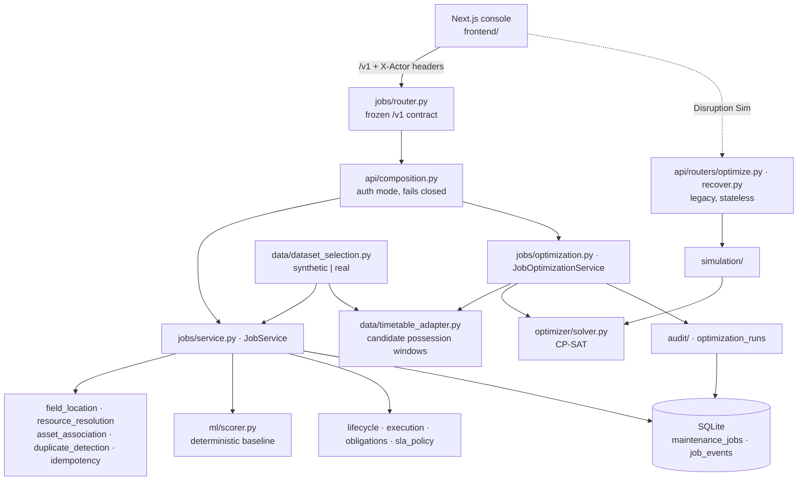
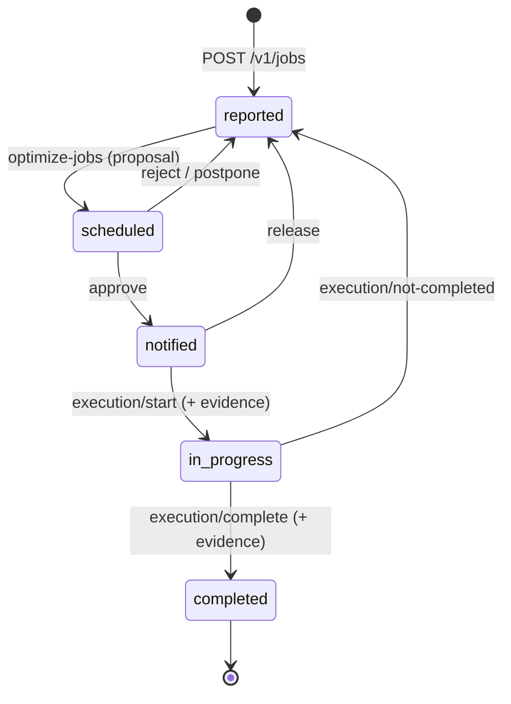

# System architecture: Pashupatastra

Pashupatastra is a decision-support prototype for planning railway maintenance blocks.
It turns field reports into scored jobs, proposes blocks with OR-Tools CP-SAT inside
train-free windows derived from the timetable, and routes every proposal through a human
authority. Execution evidence and an append-only history follow the decision. The README
gives the product overview; this page describes how the components fit together.

## Components

| Package | Responsibility |
|---|---|
| `backend/app/jobs/` | The `/v1` router and the job lifecycle: intake, location conversion and resolution, asset association, duplicate detection, idempotency, scoring hand-off, proposals, authority decisions, execution with evidence, derived SLA obligations, history. |
| `backend/app/optimizer/` | The CP-SAT model. It consumes `contracts.OptimizationRequest` and returns `OptimizationResult`. |
| `backend/app/data/` | Corridor datasets (the synthetic fallback and the real snapshot loader), the section registry, the timetable-to-window adapter, the provenance model and dataset selection. |
| `backend/app/ml/` | The fixed-weight priority and risk scorer (`BASELINE_DETERMINISTIC`). It is not trained. |
| `backend/app/identity/` | The actor model, railway scopes, the enforcing authorization policy, ES256 assertion verification, the identity directory and sessions. These are library components; see the trust model in the README. |
| `backend/app/audit/`, `persistence/` | Optimization-run records and the append-only trigger guards shared by all history tables. |
| `backend/app/simulation/` | Disruption scenarios and recovery re-solves. The legacy `/optimize` and `/recover` routes use them for the console's Disruption Sim page. |
| `contracts/` | Shared Pydantic contracts used across subsystems. |

## Job lifecycle

Every decision names the optimization run it reviewed (`expected_proposal_run_id`). A
decision based on an outdated run is refused with `409 STALE_PROPOSAL`, and the refusal
itself is recorded. See [`api-contract-v1.md`](api-contract-v1.md).

## Data flow for one optimization

1. `JobOptimizationService` collects every eligible job, plus the blocks already
   approved (`notified` or `in_progress`), which are pinned.
2. The configured dataset supplies the timetable. The timetable adapter computes which
   sections each train occupies, including a 10-minute safety buffer. Gaps of at least
   20 minutes on each `(track, section)` become candidate possession windows.
3. CP-SAT maximizes the total `risk + priority` of the scheduled jobs, subject to window
   containment, a 15-minute headway with no overlap on each `(track, section)`, the
   authority's not-before dates and committed-block pinning.
4. The run is stored in the append-only `optimization_runs` table with its request,
   result and provenance. Each placed job gets a block proposal, and each unplaced job
   gets a structured reason.

## Real vs. synthetic data

`PASHUPAT_RAILWAY_DATA` selects the dataset, and matching is exact. `real` loads the
hash-verified snapshot in `data/railway/ndls_agc/`; a broken snapshot stops start-up
instead of falling back. Unset or `synthetic` loads the checked-in synthetic dataset,
which is kept as a regression baseline. The API, the database schema and the solver are
the same in both modes. See [`REAL_DATA_INTEGRATION.md`](REAL_DATA_INTEGRATION.md).
